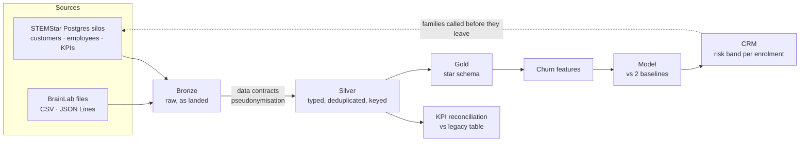

# Churn to CRM Lakehouse for a STEM Education Company 

STEMStar is a fictional education company that teaches AI to children, and it isn't using its own data.
Enrolment, attendance and renewal records sit in three separate databases with no shared keys, the renewal
KPIs are worked out by hand in a spreadsheet, and enrolment has fallen from 821 to 684 students in two years.
This project connects those databases in a lakehouse, recomputes the KPIs, predicts which families won't renew,
and sends that prediction back to the CRM so someone can call them in time.

I built it first as my MSc thesis in Big Data & Data Engineering (Complutense University of Madrid), on a real
business case. This public version uses a fictional company and fully synthetic data. The company, its
branches, its figures and every record in this repository are invented. It runs end to end on a laptop with
one command.



BrainLab is STEMStar's new AI branch. Its data arrives as files from a learning platform rather than from the
company's databases, so the pipeline has to bring two very different sources under one model.

## What the pipeline shows

All figures below come from the synthetic data, generated with seed 42.

- **The warning sign is already recorded, just in the wrong place.** Students with more than 5 absences, the
  point at which a family is owed a partial refund, renew 12% of the time, against 60% for everyone else.
  The absences live in one database and the renewals in another, and nothing joins them until Silver does.
- **The lakehouse catches the spreadsheet's mistakes.** Rebuilt from scratch, its renewal KPI matches the
  hand-kept table on 41 of 44 course-years within 1%. The three it doesn't match are the three rows the
  generator miscounts on purpose, and the reconciliation flags exactly those.
- **The model finds families at risk, modestly.** Of the enrolments ranked in the top 10% for risk, 90% did
  not renew, against 69% for a majority-class baseline. Plain logistic regression edges out gradient boosting
  here, and the report says so rather than hiding it: the value is in the ranked call list, not in the score.
- **The loop closes.** Every score reaches the CRM through the identity vault, and a run fails if one doesn't.
- **The platform watches itself.** 125 data-quality metrics per run (volume, freshness, null rates, schema
  drift, contract rejections), with blocking thresholds that stop the run.

One design lesson the data teaches: about 7% of students stop coming mid-year, their remaining sessions are
logged as cancelled, and the absence sheets count those as absences. Every one of them lands above the
threshold. So part of the absence signal says "already gone" rather than "about to go", and a next version
should flag leavers separately.

## Run it

Python 3.11 or later.

```bash
python -m venv .venv
source .venv/bin/activate        # Windows: .venv\Scripts\Activate.ps1
pip install -e ".[dev]"
pipeline run
pipeline report
```

`pipeline run` creates the synthetic extracts on first use, runs every stage into Parquet files under
`lakehouse/` and takes about 10 seconds. `pipeline report` reads the results back with DuckDB:

```
KPI reconciliation: 41 of 44 course-years within 1.0%
  off: 22-23 circuit_01: lakehouse 33 renewals, legacy table 37
  off: 24-25 forge_01: lakehouse 44 renewals, legacy table 47
  off: 25-26 forge_01: lakehouse 33 renewals, legacy table 29
Churn model (test set):
  auc_model                      0.6083
  auc_logistic                   0.6248
  auc_dummy                      0.5
  precision_at_decile_model      0.8971
  precision_at_decile_logistic   0.9118
  precision_at_decile_dummy      0.6912
  beats_baselines                False
CRM risk bands: high 364, medium 730, low 2554
Data quality: 125 metrics, 0 over threshold, 0 blocking
```

Other commands:

```bash
pipeline list-stages
pipeline run --stages gold,features,train
pipeline run --from silver --to kpi
python -m pytest
```

## The stages

| Stage | What it does |
|---|---|
| `bronze` | Lands both sources untouched, with ingestion metadata. In Fabric, Data Factory copy jobs do this. |
| `silver` | Types, deduplicates and keys every table. BrainLab must pass three data contracts (enrolment, attendance, platform logs) or the run stops. Personal data is pseudonymised: Silver keeps HMAC tokens, and only the identity vault maps a token back to a student. |
| `kpi` | Recomputes the renewal KPI per course and year and reconciles it with the legacy table, within 1%. |
| `gold` | A star schema: date, campus, student, program, employee and room dimensions, with enrolment, attendance, payment, occupancy, lead and KPI facts. No tokens reach Gold. |
| `features` | One row per enrolment: tenure, attendance rate, absences, prior renewals, refund flag, and whether the student renewed. |
| `train` | Gradient boosting against logistic regression and a majority-class baseline, trained on STEMStar and tested on its last labeled period. Scores every enrolment, BrainLab included. |
| `reverse-etl` | Joins scores to the identity vault and writes one row per enrolment to the CRM: token, score, risk band (top 10% high, next 20% medium). |
| `observability` | Profiles every table and writes the data-quality metrics. A blocking metric stops the run. |

A run also stops if a personal column or token reaches Gold or the CRM, where only `student_token` is allowed.

## From thesis to this version

The thesis version ran as eight Microsoft Fabric notebooks on private data. The examiners' one request was to
extract the shared logic into modules, make environments configurable, and add one entry point that runs
Bronze, Silver, Gold, training and Reverse ETL in order. This version does that:

- **One entry point.** `pipeline run` runs the stages in order, or any subset of them, and exits with an error
  when a gate blocks.
- **Shared modules.** Each of the eight notebooks used to carry its own copy of the bootstrap and Spark
  helpers. That code now lives once in `src/pipeline/`, and a single 15-line notebook,
  [`nb_run_stages.py`](notebooks/nb_run_stages.py), calls the same stage functions as the local command.
- **Environments as configuration.** [`config/local.yaml`](config/local.yaml) and
  [`config/fabric.yaml`](config/fabric.yaml) hold the storage backend, paths, seed, tolerances and expected row
  counts, and `PIPELINE_*` environment variables override them.
- **Synthetic sources.** Two generators ([`src/synthgen`](src/synthgen/README.md) and
  [`src/stemstar_synth`](src/stemstar_synth/README.md)) produce data with realistic structure and realistic
  mess (typos in file names, duplicate bookings, trial students who never enrol, a miscounted KPI table), so
  the whole pipeline runs for anyone.

## Layout

```
├── src/
│   ├── pipeline/         stages, CLI, settings, storage (Parquet locally, Delta in Fabric), extract parsing
│   ├── transforms/       the business logic: Silver, KPI, Gold, features, model, Reverse ETL, observability
│   ├── contracts/        data-contract loader and quality gate
│   ├── synthgen/         synthetic BrainLab sources
│   └── stemstar_synth/   synthetic STEMStar extracts
├── contracts/            the three data contracts (YAML)
├── config/               local.yaml, fabric.yaml
├── notebooks/            the Fabric notebook and how to set it up
├── supabase/01_silos.sql the three Postgres silos (the system of record)
├── scripts/              load_supabase.py (extracts to Postgres), generate_brainlab.py
├── data/synthetic/       BrainLab data (committed); STEMStar data (generated)
└── tests/                85 tests: contracts, PII, keys, KPI, Gold, model, Reverse ETL, observability, generators, a full run
```

The target stack is Microsoft Fabric (OneLake, Data Factory, Spark notebooks, Delta, MLflow) over a Postgres
system of record. Fabric won over Databricks and an open-source stack on cost, governance and how much a small
team would have to maintain.

## What this can't do

- **The data is invented.** It has realistic structure and errors, but its parameters are round numbers chosen
  to make the pipeline's job visible. The figures above describe the synthetic data, not any real company.
- **The model is a mechanism, not a product.** Its AUC is around 0.6. It ranks families for a call list; no
  one has tested whether those calls change anything.
- **No savings are claimed.** Measuring how many renewals the loop recovers would need a live trial.
- **The refactored notebook has not been re-run in Fabric.** The original notebooks ran in Fabric. The new one
  calls the same tested stages, but only the local path has been run since the refactor.
- **The "second loop" is a design only.** One idea is to return the data, k-anonymised, to the classroom as
  teaching material for BrainLab's students. Nothing here implements it.

## Author

Rudy Hernández Amezqueta · [LinkedIn](https://www.linkedin.com/in/rhamezqueta/) ·
[GitHub](https://github.com/amezdata)
